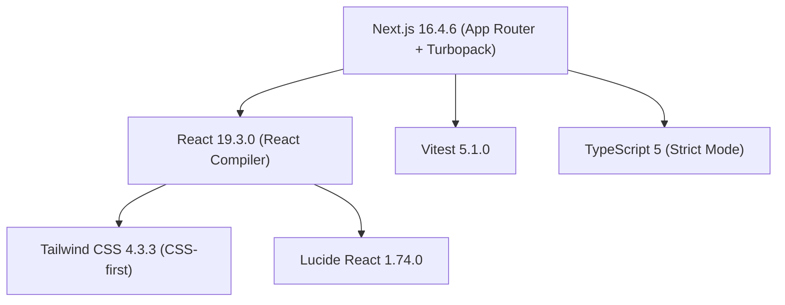

# Guide de Référence & Architecture Technique — IziFacture (AfriFacture)

> **Document de mémoire centrale du projet**  
> Ce fichier recense la vision métier, la stack technique, l'ensemble des fonctionnalités implémentées, la structure exacte des fichiers, les décisions de design et les procédures de maintenance. Il doit être consulté avant toute nouvelle évolution pour garantir une cohérence technique et visuelle absolue à 100%.

---

## 1. Vision Métier & Contexte Régional (UEMOA / CEMAC)

**IziFacture** (aussi nommé *AfriFacture*) est une plateforme SaaS de facturation et de gestion commerciale moderne conçue spécifiquement pour les PME, cliniques, cabinets de conseil, commerces et entrepreneurs d'Afrique Francophone.

### Spécificités Légales & Financières Intégrées
1. **Monnaie Exclusive en FCFA** :
   - Tous les montants financiers sont exprimés en **Franc CFA** (UEMOA `XOF` ou CEMAC `XAF`).
   - Le formatage monétaire utilise impérativement des entiers sans décimales et des espaces insécables (`\u00A0`) via la fonction universelle `formatFcfa(amount)`.
2. **TVA à 18% (Norme UEMOA / CEMAC)** :
   - Taux légal de 18% calculé rigoureusement sur le sous-total hors taxes (HT) avec arrondi à l'entier le plus proche : `Math.round(subtotalHt * 0.18)`.
   - Montant TTC = `subtotalHt + taxAmount`.
   - Calculs financiers garantis sans erreurs d'arrondis à virgule flottante (`src/lib/documents/calc.ts`).
3. **Mentions Fiscales Obligatoires** :
   - Numéro **NINEA** (Numéro d'Identification Nationale des Entreprises et Associations).
   - Numéro **RCCM** (Registre du Commerce et du Crédit Mobilier).
   - **Arrêté légal en toutes lettres** obligatoire au pied de tout document officiel généré via `formatAmountInWordsLegal(amount)` (ex: *"Arrêtée la présente facture à la somme de un million cent quatre-vingts mille Francs CFA TTC"*).
4. **Paiements par Mobile Money** :
   - Prise en charge native de **Wave** et **Orange Money**, moyens de règlement prédominants en Afrique de l'Ouest et Centrale, avec affichage des numéros marchands et QR codes.
   - Coordonnées bancaires régionales (IBAN / RIB CBAO Attijariwafa Bank).
5. **Relances & Partage WhatsApp Direct** :
   - Liens WhatsApp pré-formatés en 1 clic pour envoyer directement les factures, devis et relances aux clients sur leur messagerie mobile (`https://wa.me/...`).

---

## 2. Stack Technique & Bibliothèques



| Composant | Version / Outil | Rôle & Particularités |
|---|---|---|
| **Framework Web** | `Next.js 16.4.6` | App Router, compilation ultra-rapide Turbopack, Prerendering statique (22 routes statiques `○`), Partial Prerendering (`◐`). |
| **Moteur UI** | `React 19.3.0` & `React DOM 19.3.0` | Compatible avec le React Compiler. Interdiction stricte des appels synchrones à `setState` dans les effets (`react-hooks/set-state-in-effect`). |
| **Style & Layout** | `Tailwind CSS 4.3.3` | Approche moderne CSS-first (`@import "tailwindcss";` dans `globals.css`), variables CSS sémantiques, dégradés bordeaux personnalisés, animations CSS fluides. |
| **Typage** | `TypeScript 5` | Typage strict activé (`noUncheckedIndexedAccess: true`), détection précoce des valeurs indéfinies. |
| **Qualité de code** | `ESLint 9` (`eslint-config-next 16.4.6`) | Zéro avertissement toléré. Règles d'accessibilité et de hooks respectées. |
| **Tests Unitaires** | `Vitest 5.1.0` | Tests ultra-rapides (< 350ms) pour les calculs de montants, de TVA, de conversions en toutes lettres et de gestion de dates. |
| **Iconographie** | `lucide-react 1.74.0` | Pack complet d'icônes vectorielles cohérentes et légères. |
| **Utilitaires** | `clsx`, `tailwind-merge`, `date-fns` | Concaténation conditionnelle de classes CSS et gestion des dates. |

---

## 3. Inventaire Exhaustif des Fonctionnalités Implémentées

### A. Tableau de Bord Commercial (`/`)
- **Bandeau Hero Bordeaux Signature (`HeaderBanner`)** :
  - Dégradé de prestige bordeaux sombre (`linear-gradient(135deg, #2c040d 0%, #4e0a1a 35%, #701127 75%, #8c1733 100%)`).
  - Salutation personnalisée en typographie serif italique (*"Good Evening Ralph Edwards"*), date en français.
  - Sélecteur de pays/devise en direct (Sénégal 🇸🇳, Côte d'Ivoire 🇨🇮, Cameroun 🇨🇲, Mali 🇲🇱, Gabon 🇬🇦, etc.).
  - Recherche globale en direct de factures et clients avec fenêtre déroulante de résultats instantanés et modale de prévisualisation.
  - Bouton menu hamburger pour ouvrir le volet latéral sur tous les écrans.
- **4 Cartes KPIs Dynamiques en Temps Réel** :
  - *Total des ventes ce mois* : Recalculé automatiquement sur la somme des factures émises en FCFA.
  - *Total des dépenses* : Charges et achats opérationnels.
  - *Factures encaissées* : Total des règlements perçus (statut `paid`).
  - *Factures en attente* : Total en cours d'encaissement (statut `sent`).
  - Sparklines ondulées SVG et indicateurs de tendance en pourcentage.
- **Graphique des Ventes Mensuelles (`SalesChart`)** :
  - Histogramme mensuel sur 12 mois avec barres bordeaux texturées de rayures diagonales (`.bar-striped-burgundy`).
- **Graphique Donut de Répartition des Statuts (`InvoiceStatusDonut`)** :
  - Anneau SVG recalculé en direct à partir des factures réelles stockées.
  - Cartes de statuts avec légendes contrastées et barres en pointillés (`.pattern-dashes`) : Payées (Vert), Envoyées (Ambre), En retard (Rose), Brouillons (Gris).
- **Tableau des Dernières Factures (`RecentInvoicesTable`)** :
  - Filtres par statut (Toutes, Payées, Envoyées).
  - Trio d'actions rapides : Partage WhatsApp, Modifier (Crayon), Détails & Reçu (Œil).

---

### B. Gestion des Factures (`/invoices`, `/invoices/new`, `/invoices/[id]`, `/invoices/[id]/edit`)

#### 1. Page Liste des Factures (`/invoices`)
- Tableau Desktop complet et cartes mobiles empilées réactives.
- Filtres instantanés par statut : *Toutes*, *Payées*, *Envoyées*, *En retard*, *Brouillons* avec compteurs dynamiques.
- Recherche par nom de client, numéro de facture ou localisation.
- **Suppression sécurisée avec confirmation** : Pop-up modal épuré `z-[100]` (`bg-black/50 backdrop-blur-xs`) demandant confirmation avant suppression définitive du store.
- Synchronisation en direct : dès qu'une facture est modifiée ou supprimée, la liste se met à jour instantanément sans recharger la page.

#### 2. Espace de Création & Édition de Facture (`/invoices/new` & `/invoices/[id]/edit`)
- **Disposition 50/50 Desktop Équilibrée** : Formulaire à gauche (colonne 6) et Live Preview A4 à droite (colonne 6), garantissant plus de 100px d'espace supplémentaire pour les colonnes de prix.
- **Sélection de Client Réactive** : Menu déroulant animé avec recherche et avatar, synchronisation en temps réel avec Supabase et le store, plus bouton d'ajout de client à la volée (`CustomerModal`) avec pré-sélection automatique.
- **Sélecteur de Statut Interactif** : 4 boutons au choix (**Brouillon**, **Envoyée**, **Payée**, **En retard**) avec bordures épaisses et pastilles de couleur.
- **Dates & Références** : Numéro séquentiel modifiable (`FAC-2026-XXXX`), date d'émission et date d'échéance avec calendrier.
- **Tableau Dynamique des Lignes de Facture** :
  - Démarre vierge à 0 élément pour toute nouvelle facture (`items = []`), sans faux articles préremplis.
  - Ajout de ligne libre (`+ Add a New Item`) et suppression (`Trash2`).
  - Description, quantité, prix unitaire en FCFA.
  - Calcul instantané et rigoureux de chaque ligne, du sous-total HT, de la TVA 18% et du montant TTC.
- **Live Preview A4 Synchronisé** :
  - Rendu papier officiel avec logo d'entreprise, coordonnées émetteur/destinataire, dates et tableau aéré.
  - Gouttière garantie de 28px entre la colonne *Rate* et la colonne *Total* pour éliminer toute collision de chiffres.
  - Arrêté légal en toutes lettres affiché au bas du document.
- **Actions de Sauvegarde** : Bouton *Sauvegarder brouillon* et bouton *Enregistrer facture* avec notification toast et redirection fluide vers le détail.

#### 3. Page Détail de Facture (`/invoices/[id]`)
- Présentation officielle complète sous forme de document papier certifié.
- Sélecteur déroulant pour modifier le statut en direct (Payée, Envoyée, En retard, Brouillon).
- Bouton *Modifier* pré-remplissant l'éditeur.
- Bouton *Supprimer* avec pop-up de confirmation.
- **Téléchargement & Impression Officielle Conforme** :
  - Ouverture de la boîte de dialogue d'impression vectorielle native (« Enregistrer au format PDF ») au format A4 certifié.
  - Téléchargement simultané du fichier officiel `.html` complet avec en-tête d'entreprise, NINEA, RCCM, tableau détaillé des prestations, TVA 18%, arrêté légal en toutes lettres et coordonnées de paiement (Wave, Orange Money, RIB).
- Bouton *Partager WhatsApp* pré-remplissant le message de relance ou de remerciement.

---

### C. Annuaire Clients & Partenaires (`/customers`)
- **Cartes KPIs Portefeuille** :
  - *Portefeuille Actif* : Nombre total de clients enregistrés en zone FCFA.
  - *Facturation Cumulée* : Chiffre d'affaires total facturé, recalculé en direct sur la base des factures de chaque client.
  - *Moyenne par client* : Panier moyen facturé par compte client.
- **Tableau Desktop & Cartes Mobiles** :
  - Colonnes : *Client / Entreprise* (avec avatar dégradé bordeaux et contact principal), *Coordonnées* (email et téléphone cliquables), *Localisation* (ville, pays, adresse), *Statut*, *Facturé (FCFA)*, *Actions*.
  - **Badge de Statut Comptable du Client** :
    - 🟢 **À jour (Payé)** : si toutes les factures du client sont acquittées.
    - 🟡 **En attente** : si le client a des factures émises en cours d'échéance.
    - 🔴 **En retard** : si le client a au moins une facture dont l'échéance est dépassée.
    - ⚪ **Brouillon** : si le client n'a que des brouillons.
    - ⚪ **Aucune facture** : pour un prospect nouvellement créé.
- **Modale d'Ajout & Modification Client (`CustomerModal`)** :
  - Formulaire complet : Nom ou entreprise, contact principal, email, téléphone, ville, pays (liste des pays d'Afrique), adresse.
  - Superposition `z-[100]` avec fond épuré `bg-black/50 backdrop-blur-xs` pour une lisibilité parfaite.
  - Notification toast animée confirmant l'enregistrement du client.

---

### D. Paramètres & Formule Pro (`/settings`)
Page complète structurée en 5 onglets dédiés :
1. **Abonnement & Version Pro (`?tab=pro`)** :
   - Grande carte prestige sombre (`from-slate-950 via-slate-900 to-[#3b0814]`) avec badge doré.
   - Tarif transparent : **15 000 FCFA / mois** (ou 150 000 FCFA / an avec 2 mois offerts).
   - Checklist des 6 bénéfices majeurs : Paiements Wave & Orange Money par QR code, Relances WhatsApp & SMS automatiques, Factures et Devis illimités sans filigrane, Exports fiscaux certifiés NINEA/TVA UEMOA, Gestion multi-utilisateurs avec accès comptable, Support prioritaire 24/7.
   - Bouton interactif d'activation Pro avec notification toast de félicitations.
   - Tableau comparatif complet Découverte vs Pro.
2. **Entreprise & Établissement** :
   - Formulaire pré-rempli : Raison sociale (Clinique Al Noor), slogan, NINEA, RCCM, adresse, ville, téléphone, email officiel.
   - Enregistrement immédiat avec confirmation visuelle.
3. **Facturation & TVA (18%)** :
   - Configuration du taux de TVA (18% standard UEMOA/CEMAC), préfixe séquentiel des factures (`FAC-`), délai d'échéance par défaut en jours.
   - Rappel de l'arrêté fiscal légal UEMOA / CEMAC.
4. **Moyens de Paiement & Mobile Money** :
   - Configuration des comptes marchands Wave et Orange Money (numéros et codes marchands).
   - Coordonnées bancaires régionales (IBAN / RIB CBAO Attijariwafa Bank).
5. **Sécurité & Équipe** :
   - Profil de l'administratrice (Awa Ndiaye, Médecin Directrice).
   - Double authentification (2FA) active, politique de mot de passe sécurisée.

---

### E. Navigation Shell & Ergonomie Mobile (`AppShell`, `AppSidebar`, `SubpageHeader`)
- **Volet Latéral Escamotable (`AppSidebar`)** :
  - Défilement vertical fluide (`overflow-y-auto`) pour les 12 rubriques, débarrassé de tout encart publicitaire gênant.
  - **Fermeture Automatique** : Dès que l'utilisateur clique sur une option (*Clients*, *Factures*, *Créer une facture*, *Paramètres*), le volet se referme immédiatement pour libérer 100% de la largeur d'écran.
  - **Bouton Fermer (`✕`) Universel** : Situé en haut à droite du volet, accessible sur desktop comme sur mobile.
  - **Fermeture par Arrière-Plan & Échap** : Un clic sur le fond sombre ou la touche `Échap` referme le menu.
  - Puce profil compacte en bas de sidebar affichant l'utilisateur connecté avec bouton de déconnexion rapide (`LogOut`).
- **En-têtes Adaptatifs** :
  - **Dashboard (`/`)** : Grand bandeau bordeaux d'accueil personnalisé (`HeaderBanner`).
  - **Toutes les autres pages (`/invoices`, `/customers`, `/settings`, etc.)** : Bandeau compact épuré (`SubpageHeader`) avec fil d'Ariane interactif (`Dashboard / Factures / Nouvelle facture`), bouton menu hamburger universel, sélecteur pays/devise synchronisé et profil connecté dynamique (`userName`, `userEmail`, initiales) via `useAuth()`.

---

### F. Authentification & Inscription Moderne (`/login`)
- **Design & Layout Centré Prestige** :
  - Carte blanche arrondie `rounded-3xl` avec ombrage doux sur fond `#F8F9FB`, fidèle à la maquette de référence.
  - Emblème IziFacture stylisé avec dégradé bordeaux signature et puce `FCFA • UEMOA • CEMAC`.
- **Validation Email RFC Moderne** :
  - Vérification instantanée de l'adresse email professionnelle (`/^[a-zA-Z0-9._%+-]+@[a-zA-Z0-9.-]+\.[a-zA-Z]{2,}$/`).
- **Sécurité Mot de Passe Anti-Piratage (8 à 16 caractères)** :
  - Longueur obligatoire comprise rigoureusement entre **8 et 16 caractères**.
  - Complexité obligatoire : majuscule, minuscule, chiffre et caractère spécial.
  - Jauge visuelle de force à 4 segments (*Faible*, *Moyen*, *Bon*, *Très puissant*) avec checklist dynamique.
  - Bouton œil (`Eye` / `EyeOff`) pour afficher ou masquer le mot de passe.
- **Bascule Connexion ↔ Inscription en 1 Clic** :
  - Mode création de compte avec champ raison sociale et confirmation de mot de passe.
  - Case à cocher *"Se souvenir de moi"* et lien *"Mot de passe oublié ?"*.
  - Bouton principal bordeaux avec état de chargement animé.
  - Boutons de connexion sociale (Google et GitHub).
- **Intégration Supabase Auth & Protection Globale** :
  - Trigger PostgreSQL `handle_auto_confirm_user` pour auto-confirmer immédiatement les utilisateurs.
  - Session réactive globale via `AuthProvider` (`src/lib/auth-context.tsx`).
  - **Auth Guard & Protection des routes** (`AppShell`) : Redirection automatique vers `/login` pour tout visiteur non connecté arrivant sur la racine ou rechargeant la page.
  - **Flow d'inscription en 2 étapes** : La création d'un compte bascule l'utilisateur sur le mode « Se connecter » avec message de validation vert et email pré-rempli, sans redirection directe vers le dashboard. La connexion explicite est requise.
  - **Déconnexion propre** : Bouton visible *« Se déconnecter »* avec icône `LogOut` dans `AppSidebar`, réinitialisant intégralement la session, vidant les mots de passe et remettant `loading` à `false` (aucun blocage sur « Traitement des données »).
  - **Salutation personnalisée** : Mention prestigieuse *« Bonjour, »* suivie du prénom et nom réels de l'utilisateur (`user.user_metadata.full_name`) en typographie Serif italique.
  - **Date dynamique en temps réel** : Affichage automatique de la date du jour en français (`formatFullFrenchDate(new Date())`) au format complet.
  - **Sélecteur de devise / pays fiabilisé** : Balise `<header>` élevée avec `relative z-40`, menu déroulant `z-[100]` avec défilement fluide `overscroll-contain`, listant l'intégralité des 14 pays de la zone FCFA sans être rogné par le contenu du dashboard.

---

## 4. Architecture & Arborescence des Fichiers

```
invoice_test/
├── gemini.md                           # Ce document de référence centrale
├── AGENTS.md                           # Règles universelles pour les agents IA
├── package.json                        # Dépendances et scripts de build
├── tsconfig.json                       # Configuration stricte TypeScript
├── next.config.ts                      # Configuration Next.js 16 (Cache Components, Turbopack)
├── eslint.config.mjs                   # Configuration ESLint 9 & Next.js
├── vitest.config.mts                   # Configuration du moteur de tests unitaires Vitest
│
├── .agents/
│   └── rules/
│       └── ui-design-system.md         # Règle de cohérence UI et design system
│
├── public/                             # Assets statiques (logos, icônes)
│
├── src/
│   ├── app/                            # Next.js 16 App Router
│   │   ├── layout.tsx                  # Root Layout (polices Geist Sans, Serif et AuthProvider)
│   │   ├── globals.css                 # Import Tailwind CSS v4, dégradés bordeaux et scrollbars
│   │   ├── page.tsx                    # Page Dashboard (Route `/`)
│   │   ├── login/
│   │   │   └── page.tsx                # Page Connexion & Inscription moderne (Route `/login`)
│   │   ├── settings/
│   │   │   └── page.tsx                # Page Paramètres & Version Pro (Route `/settings`)
│   │   ├── customers/
│   │   │   └── page.tsx                # Page Annuaire Clients (Route `/customers`)
│   │   └── invoices/
│   │       ├── page.tsx                # Page Liste des Factures (Route `/invoices`)
│   │       ├── new/
│   │       │   └── page.tsx            # Page Créer une Facture (Route `/invoices/new`)
│   │       └── [id]/
│   │           ├── page.tsx            # Page Détail de Facture (Route `/invoices/[id]`)
│   │           └── edit/
│   │               └── page.tsx        # Page Modifier Facture (Route `/invoices/[id]/edit`)
│   │
│   ├── components/
│   │   ├── auth/                       # Authentification & Inscription
│   │   │   └── AuthForm.tsx            # Formulaire moderne avec jauge de force, RFC email & Supabase Auth
│   │   │
│   │   ├── layout/                     # Squelette et navigation globale
│   │   │   ├── AppShell.tsx            # Conteneur global, gestion de la sidebar et du pays actif
│   │   │   ├── AppSidebar.tsx          # Volet latéral 12 rubriques escamotable, profil connecté et déconnexion
│   │   │   ├── HeaderBanner.tsx        # Grand bandeau bordeaux Hero du Dashboard avec recherche live
│   │   │   └── SubpageHeader.tsx       # En-tête compact pour les sous-pages avec fil d'Ariane
│   │   │
│   │   ├── dashboard/                  # Composants exclusifs au Dashboard
│   │   │   ├── DashboardView.tsx       # Orchestrateur du Dashboard et calcul des KPIs
│   │   │   ├── DashboardHeader.tsx     # Salutation secondaire et filtres de période
│   │   │   ├── KpiCard.tsx             # Carte statistique avec montant, sparkline et tendance
│   │   │   ├── SalesChart.tsx          # Histogramme mensuel dynamique avec rayures diagonales bordeaux
│   │   │   ├── InvoiceStatusDonut.tsx  # Graphique Donut SVG dynamique de répartition des statuts
│   │   │   ├── RecentInvoicesTable.tsx # Tableau des dernières factures avec filtres et Empty State
│   │   │   └── InvoiceDetailModal.tsx  # Modale d'aperçu rapide déclenchée depuis la recherche
│   │   │
│   │   ├── invoices/                   # Composants de gestion de factures
│   │   │   ├── InvoicesListView.tsx    # Tableau desktop, cartes mobiles et Empty State avec CTA
│   │   │   ├── InvoiceEditor.tsx       # Formulaire de création/édition 50/50 avec sélecteur de statut
│   │   │   ├── LiveDocumentPreview.tsx # Rendu papier A4 synchronisé en temps réel
│   │   │   ├── InvoiceDetailView.tsx   # Vue complète A4 de consultation d'une facture
│   │   │   └── EditInvoiceClient.tsx   # Wrapper client pour le pré-chargement en édition
│   │   │
│   │   ├── customers/                  # Composants de gestion des clients
│   │   │   ├── CustomersListView.tsx   # Tableau clients avec statut comptable, KPIs cumulés et Empty State
│   │   │   └── CustomerModal.tsx       # Modale d'ajout et d'édition client (z-[100])
│   │   │
│   │   ├── settings/                   # Composants des paramètres
│   │   │   └── SettingsView.tsx        # Vue 5 onglets avec persistance Supabase
│   │   │
│   │   └── shared/                     # Composants UI partagés et transversaux
│   │       ├── Money.tsx               # Formatage garanti en FCFA avec espaces insécables
│   │       ├── PageHeader.tsx          # En-tête de section unifié (titre, badge, actions)
│   │       └── StatusBadge.tsx         # Badge de statut universel à bordure épaisse contrastée
│   │
│   └── lib/                            # Moteur logique, calculs, utilitaires et store
│       ├── auth-context.tsx            # Contexte & Provider Supabase Auth (session, user, signIn, signUp, signOut)
│       ├── store.ts                    # Store réactif hybride (Optimistic UI + Supabase Cloud + Realtime WebSocket)
│       ├── mock-data.ts                # Modèles TypeScript (Invoice, Customer, KpiStat)
│       ├── money.ts                    # Fonctions formatFcfa() et gestion des devises
│       ├── dates.ts                    # Formatage des dates JJ/MM/AAAA
│       ├── amount-in-words.ts          # Conversion de montants FCFA en lettres certifiées conformes
│       ├── countries.ts                # Référentiel des pays africains (drapeaux, devises, villes)
│       ├── utils.ts                    # Helper cn() pour les classes conditionnelles Tailwind
│       ├── supabase/                   # Couche Supabase Full-Stack
│       │   ├── client.ts               # Client Supabase singleton avec support WebSocket Realtime
│       │   └── types.ts                # Typage strict généré de la base PostgreSQL
│       └── documents/
│           └── calc.ts                 # Calculs rigoureux des totaux HT, TVA 18% et TTC
│
└── tests/
    └── unit/                           # Tests unitaires Vitest
        ├── money.test.ts               # Tests du formateur FCFA et symboles monétaires
        ├── calc.test.ts                # Tests des calculs financiers et de la TVA 18%
        ├── amount-in-words.test.ts     # Tests de la conversion de nombres en lettres françaises
        └── dates.test.ts               # Tests du formatage de dates en JJ/MM/AAAA et français complet
```

---

## 5. Universal Design System & Règles de Cohérence UI

Toutes les pages doivent respecter rigoureusement les conventions établies sur le Dashboard :

### 1. Couleurs & Dégradés
- **Fond de l'application** : `#F8F9FB` (`bg-[#F8F9FB]`).
- **Dégradé Bordeaux Hero** : `.burgundy-banner-gradient` (`linear-gradient(135deg, #2c040d 0%, #4e0a1a 35%, #701127 75%, #8c1733 100%)`).
- **Accentuation Bordeaux** : `#701127` (boutons primaires, liens actifs, surbrillances).
- **Cartes Blanches** : `bg-white rounded-2xl border border-slate-200/70 shadow-xs hover:shadow-md transition-all`.

### 2. Badges de Statuts (Bordures Épaisses Obligatoires `border-2`)
Chaque statut utilise un contraste renforcé avec anneau d'ombrage (`ring-2`) pour une lisibilité parfaite :
- 🟢 **Payée (`paid`)** : `border-2 border-emerald-500 bg-emerald-50/90 text-emerald-900 ring-2 ring-emerald-500/20 font-bold`.
- 🟡 **Envoyée (`sent`)** : `border-2 border-amber-500 bg-amber-50/90 text-amber-900 ring-2 ring-amber-500/20 font-bold`.
- 🔴 **En retard (`overdue`)** : `border-2 border-rose-500 bg-rose-50/90 text-rose-900 ring-2 ring-rose-500/20 font-bold` (avec puce animée `animate-pulse`).
- ⚪ **Brouillon (`draft`)** : `border-2 border-slate-400 bg-slate-100/90 text-slate-800 ring-2 ring-slate-400/20 font-bold`.

### 3. Typographie
- **Noms & Titres Prestigieux** : Typographie Serif italique de luxe (`font-serif italic font-normal`).
- **Texte Général** : Sans-serif épuré (`font-sans`).
- **Montants & Numéros de Documents** : Monospace pour alignement parfait des chiffres (`font-mono font-bold`).

### 4. Tableaux Desktop vs Cartes Mobiles
Toute liste de données doit comporter une double déclinaison :
- **Desktop (`hidden md:block`)** : Élément `table` avec en-têtes `bg-slate-50/75 border-b border-slate-100 text-[11px] font-bold text-slate-400 uppercase tracking-wider py-3 px-4`.
- **Mobile (`md:hidden`)** : Cartes individuelles empilées `p-4 rounded-xl bg-slate-50/60 border border-slate-200/80 space-y-3 shadow-2xs`.
- **Trio d'Actions Rapides** :
  - 🟢 **WhatsApp** : bouton vert émeraude ouvrant directement l'application avec message pré-rempli.
  - ✏️ **Modifier** : icône crayon menant à l'éditeur.
  - 👁️ **Détail & PDF** : bouton d'accès au document complet.

### 5. Modales & Pop-ups (`z-[100]`)
Toutes les modales (Ajout de client, Suppression de facture, Aperçu) utilisent une superposition de niveau supérieur `z-[100]` avec arrière-plan sombre diffusant `bg-slate-950/80 backdrop-blur-md` pour couvrir intégralement la barre latérale (`z-50`) et l'en-tête (`z-30`).

---

## 6. Architecture Full-Stack Supabase Cloud & Store Réactif Hybride

L'application est connectée directement à une base PostgreSQL 17 hébergée sur **Supabase** (`papychuloo's Project` - `bfwmiqqmggainwyeaapp`).

### A. Modèle de Données PostgreSQL & Tables
1. **`public.customers`** : Annuaire des clients et prospects avec calculs cumulés (`total_invoiced`, `invoices_count`).
2. **`public.invoices`** : Factures émises avec statut (`draft`, `sent`, `paid`, `overdue`), montant TTC en FCFA, sous-total HT, TVA 18%, dates et coordonnées client.
3. **`public.invoice_items`** : Lignes d'articles rattachées à la facture avec cascade de suppression (`ON DELETE CASCADE`).
4. **`public.company_settings`** : Configuration fiscale (NINEA, RCCM, TVA 18%), coordonnées de l'établissement (Clinique Al Noor), comptes Mobile Money (Wave, Orange Money) et état d'abonnement Pro.

### B. Sécurité & RLS (Row Level Security)
- Row Level Security (RLS) activé sur l'ensemble des 4 tables.
- Politiques d'accès publiques (Option A) configurées pour permettre la lecture, l'insertion, la mise à jour et la suppression via la clé anonyme autorisée.

### C. Synchronisation Hybride & Temps Réel (Realtime WebSocket)
- **Zéro latence (Optimistic UI)** : Toute action de l'utilisateur (création, modification, changement de statut, suppression) s'applique immédiatement dans l'interface et dans le cache local (0 milliseconde de délai perçu).
- **Persistance Asynchrone Supabase** : L'opération est répercutée en tâche de fond dans PostgreSQL via le SDK `@supabase/supabase-js`.
- **Canal WebSocket Realtime (`supabase.channel`)** : Abonnement actif sur les événements `INSERT`, `UPDATE`, `DELETE` des tables PostgreSQL. Dès qu'une modification survient (par exemple depuis un autre appareil ou la console Supabase), tous les écrans connectés se mettent à jour automatiquement en direct sans recharger la page.
- **Synchronisation Automatique Factures ↔ Clients (`syncCustomersBilling`)** : Le chiffre d'affaires cumulé et le nombre de factures de chaque client sont recalculés et persistés en base à chaque mise à jour.

---

## 7. Commandes de Développement & Validation

Toutes les commandes doivent être exécutées avec `npm.cmd` sous Windows PowerShell :

```powershell
# 1. Démarrer le serveur de développement local (sur http://localhost:3000)
npm.cmd run dev

# 2. Vérification statique du typage TypeScript (0 erreur requise)
npm.cmd run typecheck

# 3. Contrôle du linter ESLint (0 erreur, 0 avertissement requis)
npm.cmd run lint

# 4. Exécution de la suite de tests unitaires Vitest
npm.cmd test

# 5. Compilation de production Next.js avec Turbopack (22 routes statiques générées)
npm.cmd run build

# 6. Démarrage du serveur de production compilé
npm.cmd run start
```

---

## 8. Guide d'Ajout de Nouveaux Modules (Devis, Dépenses, Rapports)

Lors de l'implémentation des prochains modules mentionnés dans le menu latéral :

1. **Créer la route correspondante dans `src/app/`** :
   - Ex: `src/app/quotes/page.tsx` pour les Devis, `src/app/expenses/page.tsx` pour les Dépenses.
   - Toujours encapsuler le contenu dans `<AppShell>` pour hériter automatiquement de la navigation et de la fermeture automatique du volet.
2. **Utiliser `<PageHeader>`** :
   - Titre, sous-titre explicatif, badge contextuel et bouton d'action primaire bordeaux.
3. **Appliquer la règle bivalente Desktop / Mobile** :
   - Tableau pour desktop (`hidden md:block`) et cartes empilées pour mobile (`md:hidden`).
4. **Brancher les montants sur `Money`** :
   - `<Money amount={valeur} />` garantit le formatage FCFA et l'espace insécable `\u00A0`.
5. **Utiliser `StatusBadge` pour les statuts** :
   - Respecter les 4 couleurs standardisées (Émeraude, Ambre, Rose, Ardoise).
6. **Mettre à jour `SubpageHeader.tsx`** :
   - Ajouter le fil d'Ariane correspondant dans la fonction `getBreadcrumbs()`.

---

*Fichier de référence officiel IziFacture — Mis à jour en continu à chaque étape validée.*
